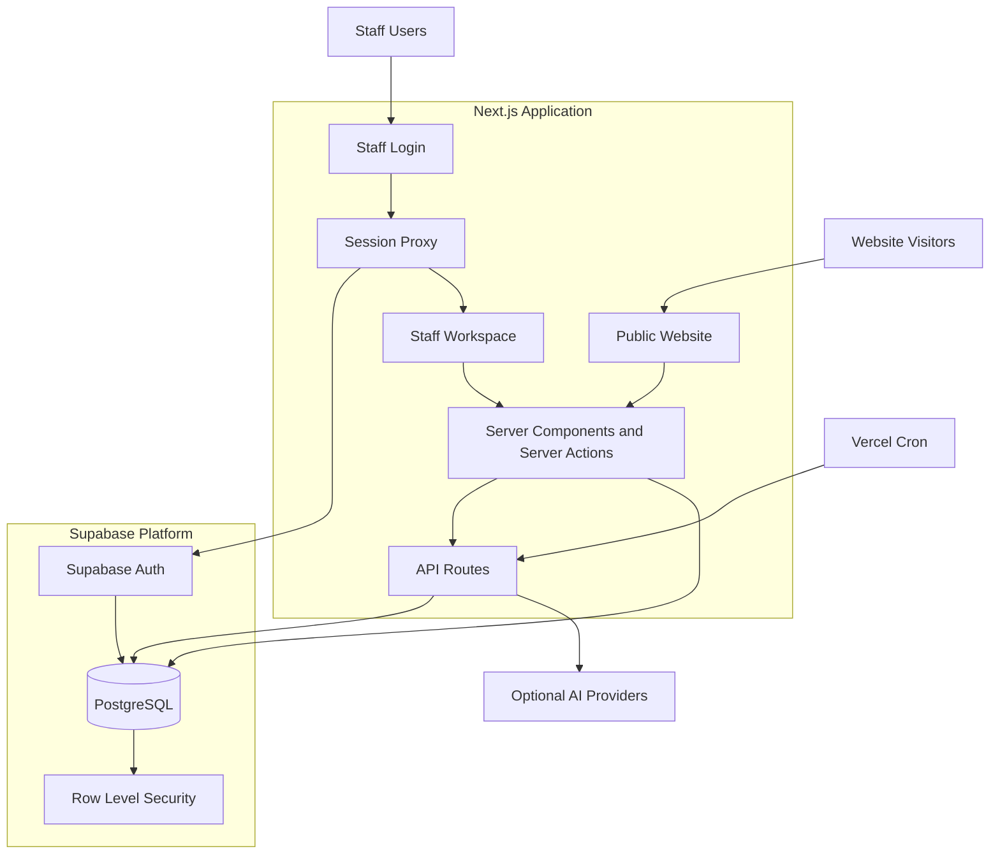
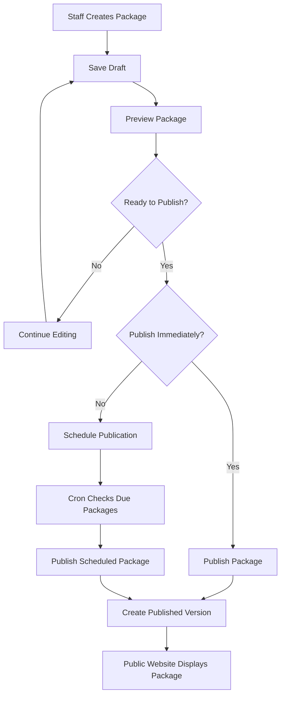
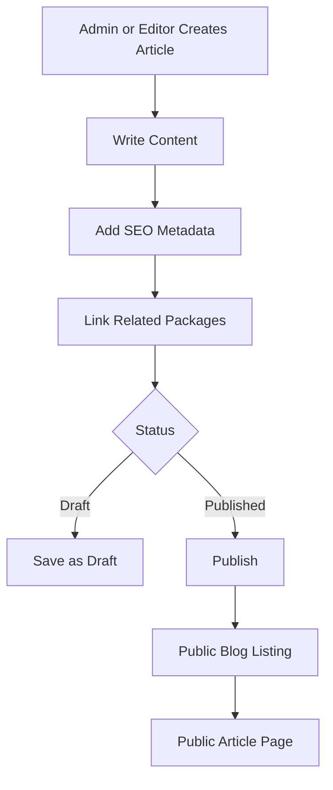
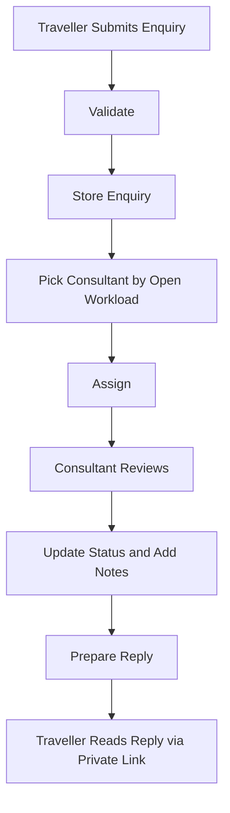
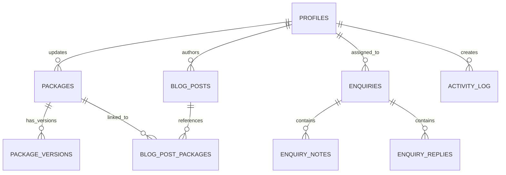
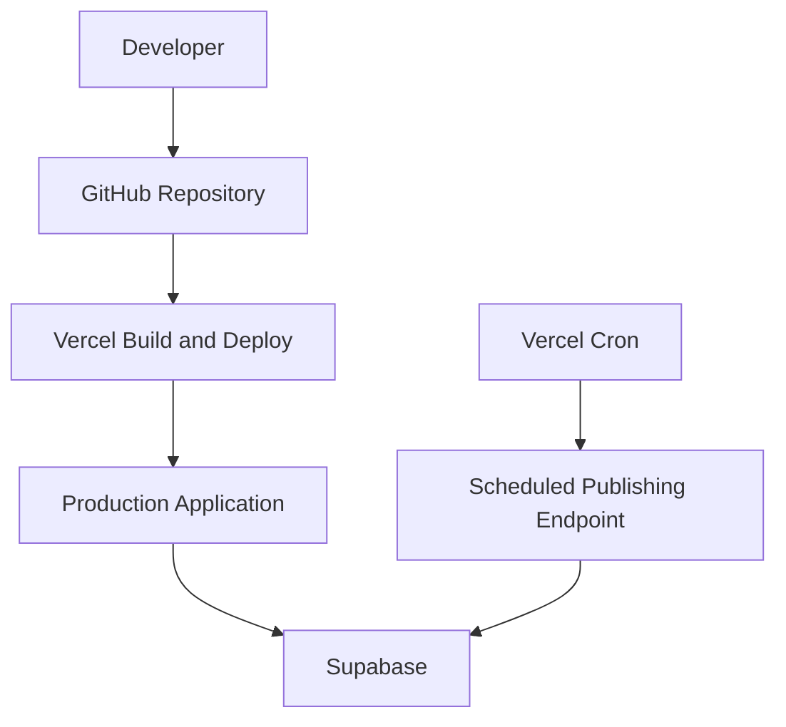

# Rocky Travel

**A travel website and staff workspace for Kerala and South India holidays.**

[Live site](https://touroperatorswebsite.vercel.app/) · [Repository](https://github.com/Rakesh-honawad/vantage) · [License: MIT](./LICENSE)

Rocky Travel lets travellers explore holiday packages, read travel articles and send enquiries. Behind the public site sits a role-based staff workspace where editors publish packages and articles, and consultants work through traveller enquiries. The codebase lives in the `vantage` repository.

---

## Demo Staff Login

The Rocky Travel staff workspace supports three demo roles.

| Role | Login Email |
|---|---|
| Admin | `rakesh.admin@example.com` |
| Editor | `devika.editor@example.com` |
| Consultant | `arun.consultant@example.com` |

**Login URL:** https://touroperatorswebsite.vercel.app/login

**Password:** Rakesh1432rk

> **Security:** Demo credentials are provided for demonstration purposes only.

---

## Contents

1. [At a glance](#1-at-a-glance)
2. [Product overview](#2-product-overview)
3. [Users and roles](#3-users-and-roles)
4. [System design](#4-system-design)
5. [Key design decisions](#5-key-design-decisions)
6. [Core workflows](#6-core-workflows)
7. [Data design](#7-data-design)
8. [Security and privacy](#8-security-and-privacy)
9. [AI assistance](#9-ai-assistance)
10. [Localization](#10-localization)
11. [Technology stack](#11-technology-stack)
12. [Codebase map](#12-codebase-map)
13. [Getting started](#13-getting-started)
14. [Configuration](#14-configuration)
15. [Testing and quality](#15-testing-and-quality)
16. [Deployment and operations](#16-deployment-and-operations)
17. [Status, limitations and roadmap](#17-status-limitations-and-roadmap)
18. [License](#18-license)

---

## 1. At a glance

| | |
|---|---|
| **What it is** | Public travel website plus authenticated staff workspace |
| **Audience** | Travellers planning Kerala and South India trips; tour-operator staff |
| **Core capabilities** | Package catalogue, versioned publishing, blog, enquiry inbox, optional AI assistance |
| **Staff roles** | Admin, Editor, Consultant |
| **Built with** | Next.js, React, TypeScript, Supabase (Auth and PostgreSQL), Vercel |
| **Languages** | English, Hindi, German interface selection |
| **Live deployment** | https://touroperatorswebsite.vercel.app/ |

---

## 2. Product overview

### Public website

Travellers can:

- Browse holiday packages and destinations across Kerala and South India.
- Open a package to see its itinerary, hotels, inclusions, exclusions and seasonal pricing.
- Search and filter the catalogue.
- Read travel articles linked to relevant packages.
- Submit an enquiry about a specific package or a general trip.
- Follow their enquiry and read replies through a private link, with no account needed.
- Switch the interface between English, Hindi and German.

### Staff workspace

| Module | Purpose |
|---|---|
| Dashboard | Entry point and navigation for staff |
| Packages | Draft, preview, schedule, publish, duplicate and version packages |
| Blog | Write, categorize and publish travel articles, linked to packages |
| Enquiries | Review, assign, annotate and reply to traveller enquiries |
| Activity log | Admin-only record of significant staff actions |

---

## 3. Users and roles

Three staff roles divide the workspace by responsibility, so each person sees only the tools they need.

| Capability | Admin | Editor | Consultant |
|---|:---:|:---:|:---:|
| Open the staff workspace | ✓ | ✓ | ✓ |
| Create, edit and publish packages | ✓ | ✓ | |
| Create, edit and publish blog posts | ✓ | ✓ | |
| View and manage enquiries | ✓ | | ✓ |
| Add internal enquiry notes | ✓ | | ✓ |
| View the activity log | ✓ | | |

Travellers are not logged-in users. They interact through the public site and a private enquiry link.

> **Principle:** permissions are enforced on the server and again in the database. Hiding a menu item is never treated as access control.

---

## 4. System design

### 4.1 High-level architecture

Rocky Travel is a single full-stack Next.js application. Next.js renders public pages, serves the staff workspace, runs server actions and exposes a small set of API routes. Supabase provides authentication and the PostgreSQL database. Vercel hosts the application and triggers scheduled publishing.



### 4.2 Layers and responsibilities

| Layer | Responsibility |
|---|---|
| Presentation | Public pages, staff pages, forms and shared UI components |
| Application | Server components, server actions and API route handlers |
| Authentication | Supabase Auth with cookie-based server sessions |
| Authorization | Server-side staff role checks on every protected page and action |
| Data | PostgreSQL tables, views, relationships and constraints |
| Database security | Row Level Security policies as a second line of defence |
| Background work | Scheduled package publishing through Vercel Cron |
| Integrations | Optional AI providers; messaging channels pending |

### 4.3 Request lifecycle

1. A visitor or staff member requests a page.
2. Next.js routes the request and renders the page on the server.
3. For protected areas, the session is refreshed and the user's role is checked.
4. Server code reads or writes data through Supabase.
5. PostgreSQL applies constraints and Row Level Security.
6. The response goes back to the browser.

---

## 5. Key design decisions

| Decision | Reasoning |
|---|---|
| **One full-stack Next.js app** | One codebase and one deployment for both the public site and the staff workspace keeps a small team productive. |
| **Server-rendered public pages** | Fast first load and clean, crawlable URLs, which matter for travel search traffic. |
| **Draft and published versions for packages** | Editors can change content safely, preview it, and publish deliberately. Version history supports rollback. |
| **Public pages read a dedicated view** | Public pages use a `public_packages` view over published data only, so drafts and internal fields are never exposed. |
| **Authorization on server and in the database** | Role checks in server code are backed by Row Level Security, so a bug in one layer does not expose data. |
| **Privileged key stays server-side** | The Supabase service-role key is used only in server-only code and never reaches the browser. |
| **Private-link enquiry tracking** | Travellers follow an enquiry without creating an account, using an unguessable token. |
| **AI is advisory and optional** | The enquiry workflow works without AI. When AI is on, staff review its output before anything is sent. |
| **Rule-based enquiry assignment** | New enquiries go to the consultant with the fewest open enquiries, which spreads workload without manual triage. |
| **Pricing from package data** | Prices shown or quoted come from the seasonal price tables, never from AI output. |

---

## 6. Core workflows

### 6.1 Package publishing

Packages keep editable draft content separate from the published version that visitors see.



What this gives the business:

- Safe editing without affecting the live site.
- Preview before anything goes public.
- Scheduled launches, for example a seasonal offer.
- A version history for every publish.
- Stable public URLs when content changes.

### 6.2 Blog publishing

Articles are managed separately from packages and can be linked to them, so an article about a destination can point readers to matching trips.



Articles have a title and slug, summary, category, cover image, body, SEO title and description, and a draft, published or archived status. Drafts stay private.

### 6.3 Traveller enquiry handling



An enquiry records the traveller's contact details, the related package if any, the message and channel, WhatsApp consent, status, assignee, internal notes and replies. Consultants correct details, update status and respond. Travellers see replies through their private link.

---

## 7. Data design

### 7.1 Main entities

| Entity | Purpose |
|---|---|
| Profiles | Staff identity and role |
| Packages | Package records with draft content and publishing state |
| Package versions | History of published versions |
| Activity log | Record of significant staff actions |
| Enquiries | Traveller enquiries with status, assignee and private token |
| Enquiry notes | Internal staff notes |
| Enquiry replies | Replies prepared for travellers |
| Blog posts | Article content and publishing metadata |
| Blog post packages | Links between articles and packages |

### 7.2 Entity relationships



### 7.3 Data access

| Need | Approach |
|---|---|
| Public package pages | Read from the published-packages view only |
| Staff package work | Protected server-side access |
| Blog pages | Published articles only for the public; role-gated for staff |
| Enquiries | Authorized staff, plus the private-token flow for the traveller |
| Defence in depth | Row Level Security on application tables |

---

## 8. Security and privacy

Security is applied at several layers, so no single mistake exposes data.

**Authentication**
- Supabase Auth manages staff accounts.
- Sessions are cookie-based and verified on the server.
- Signed-out users are redirected to the login page.

**Authorization**
- Roles are stored in the staff profile.
- Every protected page and action checks the role on the server.
- Admin-only features, such as the activity log, are restricted to admins.

**Database**
- Row Level Security is enabled on application tables.
- Public access is limited to intended published content.
- RLS is never disabled to work around a permission error.

**Secrets**
- The service-role key and AI keys are server-only.
- Nothing secret is exposed through public environment variables.
- Environment files are never committed or shipped in submissions.

**Input and links**
- Enquiry input is validated on the server before storage.
- Private enquiry links use unguessable tokens and are kept out of public listings and logs.

**Privacy**
- WhatsApp consent is recorded with each enquiry.
- Traveller details should not be written to logs.
- A draft privacy page is included. It is not a substitute for legal review before launch.

---

## 9. AI assistance

AI is an optional layer on top of the enquiry workflow.

When configured, it can:

- Extract structured details, such as dates, group size and interests, from a free-text message.
- Suggest suitable published packages.
- Draft a reply for the consultant.

Design rules:

- Staff always review AI output next to the original message.
- Nothing is sent or published automatically.
- Prices in a draft come from package pricing data, never from the model.
- A deterministic fallback keeps the workflow working when AI is unavailable.
- Personal data sent to a provider should be minimal and covered by the privacy notice.

---

## 10. Localization

The public interface can be switched between **English**, **Hindi** and **German**.

- English is the default.
- The selected language persists across navigation.
- Interface labels and travel content are treated separately. Package details, prices and articles are not machine-translated silently.
- Coverage of every page and all content in Hindi and German is still being verified.

---

## 11. Technology stack

| Area | Technology |
|---|---|
| Framework | Next.js (App Router) |
| UI | React |
| Language | TypeScript |
| Styling | CSS |
| Database | PostgreSQL on Supabase |
| Authentication | Supabase Auth |
| Validation | Zod |
| Testing | Vitest |
| Hosting | Vercel |
| Scheduled jobs | Vercel Cron |
| Optional AI | Gemini and xAI-compatible providers |
| Source control | Git and GitHub |

---

## 12. Codebase map

| Area | Responsibility |
|---|---|
| `app/` | Routes, layouts and server actions |
| `app/admin/` | Protected staff workspace: packages, blog, enquiries, activity |
| `app/api/` | Server endpoints, including enquiry intake and scheduled publishing |
| `app/blog/`, `app/packages/`, `app/destinations/` | Public content pages |
| `app/enquiry/` | Private enquiry tracking for travellers |
| `components/` | Reusable public and staff UI |
| `lib/` | Shared logic: auth, data access, pricing, blog, localization, types |
| `lib/supabase/` | Supabase client setup, including the server-only admin client |
| `supabase/migrations/` | Database migrations for scheduling, inbox and blog features |
| `proxy.ts` | Session refresh and route protection |

### Public routes

| Route | Purpose |
|---|---|
| `/` | Home |
| `/packages` and `/packages/[slug]` | Catalogue and package details |
| `/destinations` | Destination content |
| `/blog` and `/blog/[slug]` | Articles |
| `/enquiry/[token]` | Private enquiry tracking |
| `/privacy` | Privacy information |
| `/login` | Staff login |

### Staff routes

| Route | Access |
|---|---|
| `/admin` | Any signed-in staff |
| `/admin/packages` | Admin, Editor |
| `/admin/blog` | Admin, Editor |
| `/admin/enquiries` | Admin, Consultant |
| `/admin/activity` | Admin |

---

## 13. Getting started

**Prerequisites:** Node.js, npm, Git and a Supabase project.

```bash
git clone https://github.com/Rakesh-honawad/vantage.git
cd vantage
npm install
```

Create a `.env.local` file using the variables in [Configuration](#14-configuration), then:

```bash
npm run dev
```

Open http://localhost:3000.

### Database setup

The database needs the base schema plus the feature migrations for scheduling, inbox and blog. The migrations are not a complete replacement for the base schema. Before applying them:

1. Check which tables and columns already exist.
2. Apply the migrations in order.
3. Review Row Level Security policies and grants.
4. Check the published-packages view and each role's access.

---

## 14. Configuration

Set these in `.env.local` for local work and in Vercel for production.

| Variable | Purpose |
|---|---|
| `NEXT_PUBLIC_SITE_URL` | Public URL of the application |
| `NEXT_PUBLIC_SUPABASE_URL` | Supabase project URL |
| `NEXT_PUBLIC_SUPABASE_ANON_KEY` | Public Supabase key |
| `SUPABASE_SERVICE_ROLE_KEY` | Server-only privileged key |
| `DEMO_PASSWORD` | Shared password for seeded demo accounts |
| `CRON_SECRET` | Protects the scheduled-publishing endpoint |
| `GEMINI_API_KEY` | Optional Gemini access |
| `XAI_API_KEY` | Optional xAI access |
| `AI_PROVIDER` | Which AI provider to use |
| `AI_MODEL` | Which model to use |
| `AI_BASE_URL` | Optional provider endpoint |

Never commit `.env.local` or expose server-side secrets to the browser.

---

## 15. Testing and quality

Automated checks:

| Check | Command |
|---|---|
| Type check | `npm exec -- tsc --noEmit` |
| Unit tests | `npx vitest run` |
| Production build | `npm run build` |

Manual verification after changes or a deployment:

- **Public site:** home loads, published packages and articles appear, drafts do not, enquiry validation works.
- **Staff access:** signed-out users are redirected, each role sees only its own modules, forbidden actions are rejected on the server.
- **Publishing:** scheduled packages go live when due.
- **Enquiries:** assignment, status changes, notes and private links behave correctly.

---

## 16. Deployment and operations

| Service | Role |
|---|---|
| Vercel | Hosts the Next.js application and runs cron |
| Supabase | Authentication and PostgreSQL |
| GitHub | Source control; pushes to `main` trigger deployments |



Before going live:

1. Set production environment variables in Vercel.
2. Point the app at the production Supabase project.
3. Configure authentication redirect URLs in Supabase.
4. Verify tables, the public view and Row Level Security policies.
5. Set `CRON_SECRET` and configure the scheduled publishing job.
6. Run a production build.
7. Test public and staff workflows on the deployed site.

Production: https://touroperatorswebsite.vercel.app/

---

## 17. Status, limitations and roadmap

### Current status

| Feature | Status |
|---|---|
| Public travel website | Implemented |
| Package management, versioning and scheduling | Implemented |
| Staff authentication and role-based access | Implemented |
| Blog management with package links | Implemented |
| Enquiry management and consultant assignment | Implemented |
| Private enquiry tracking | Implemented |
| Activity logging | Implemented |
| Language selection (EN, HI, DE) | Implemented; content coverage being verified |
| AI-assisted enquiry processing | Optional, needs provider configuration |
| WhatsApp messaging | Mock or queued only; no live delivery |
| Email delivery | Not connected to a live provider |

### Known limitations

- Replies are not delivered through live WhatsApp or email yet.
- Translations of all content are not complete.
- Redirects from legacy site URLs need confirming against the real old URLs.
- Page performance has not been measured against a formal target on production.
- The privacy page is a draft and needs legal review before launch.

### Roadmap

**Quote builder and branded PDF.** Consultants will create a quote from an enquiry and a package, with prices calculated from the package price tables. The quote will be saved with a snapshot of the pricing terms, so later package edits do not change a quote already sent. Travellers will receive a branded PDF and a secure, expiring read-only link.

Decisions needed first: whether prices include GST, how child pricing works, whether consultants may discount and who approves it, the validity period, and a PDF renderer that handles Hindi and German text on the hosting platform.

**Other planned improvements**
- Live email and WhatsApp delivery with recorded consent.
- Complete Hindi and German coverage.
- Rate limiting on public endpoints.
- Performance measurement and tuning on production.

---

## 18. License

Released under the [MIT License](./LICENSE). Copyright © 2026 Rakesh Honawad.

---

**Rocky Travel: Explore South India. Experience more.**
